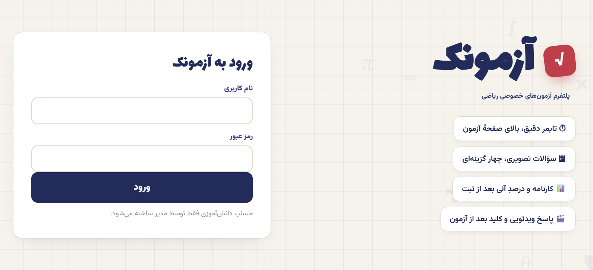
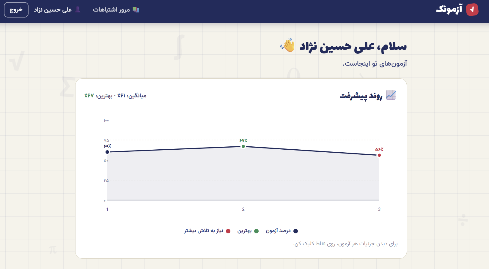
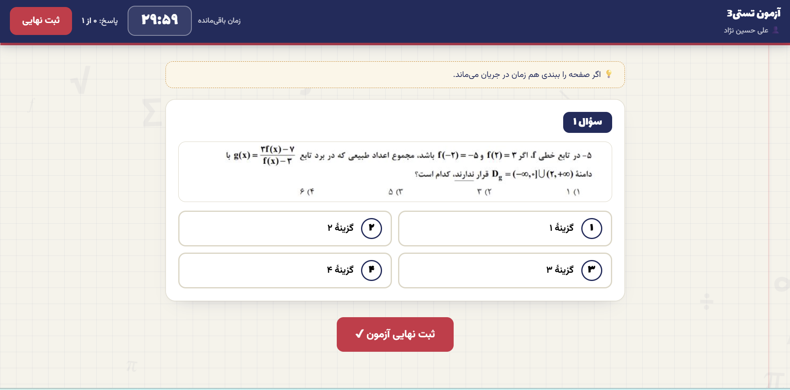
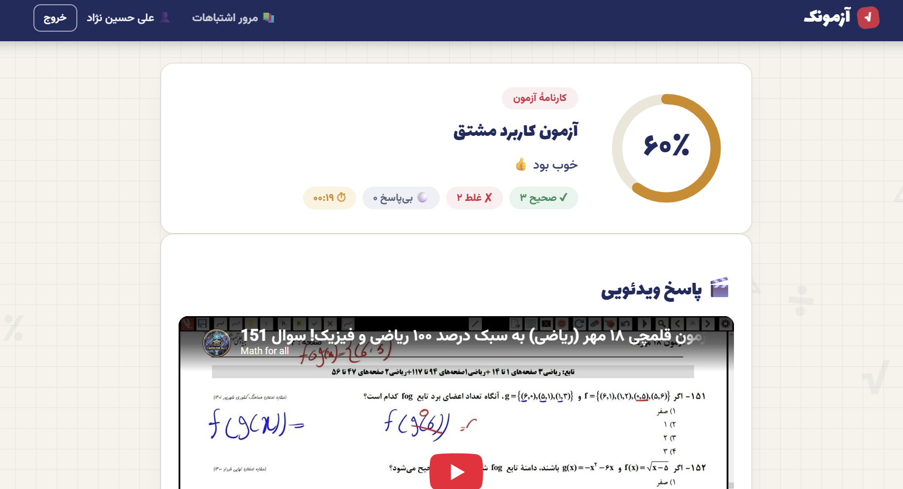
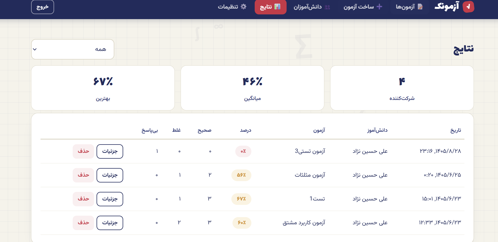
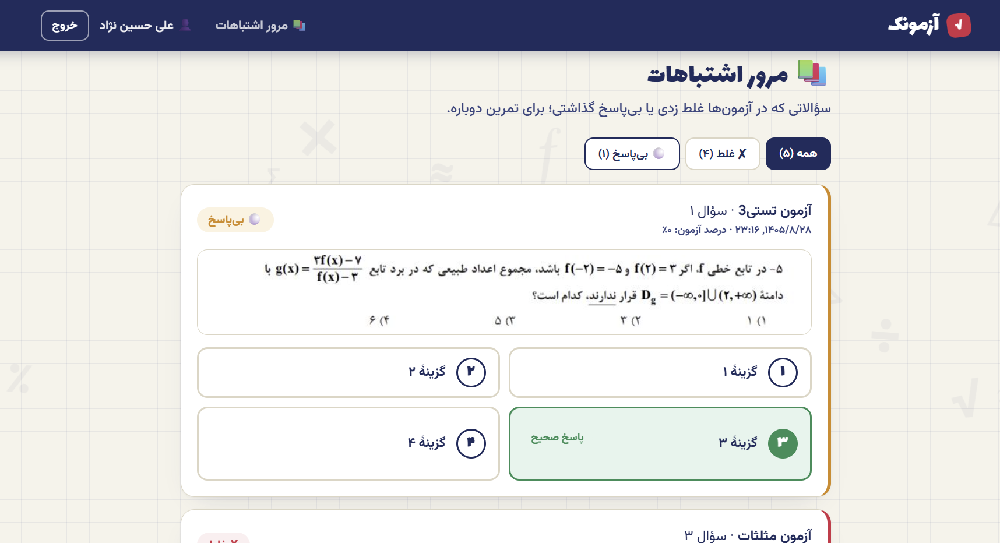

# 📝 Azmoonak

> **A Modern Quiz Platform** — Real-time analytics, progress tracking, and comprehensive admin panel.


---

## 📖 Table of Contents

- [About the Project](#-about-the-project)
- [Features](#-features)
- [Screenshots](#-screenshots)
- [Technologies Used](#-technologies-used)
- [Project Structure](#-project-structure)
- [Credits](#-credits)
- [License](#-license)

---

## 🎯 About the Project

**Azmoonak** is a sleek, RTL-supported web application designed for conducting private, timed math quizzes. It provides students with an engaging exam environment featuring image-based questions, negative scoring, instant result calculation, and interactive progress charts. Administrators can effortlessly create quizzes, manage student accounts, restrict access to specific exams, and review detailed performance analytics.

---

## ✨ Features

| Category | Features |
| :--- | :--- |
| 📝 **Quiz Engine** | Timed exams with negative scoring, image-based questions, auto-save answers, and countdown warnings. |
| 📊 **Analytics** | Instant grade calculation, interactive SVG line charts for progress tracking, and detailed performance metrics. |
| 📚 **Review Mode** | Dedicated section for students to review past mistakes and unanswered questions for future practice. |
| 🎬 **Video Solutions** | Embed educational videos (Aparat, YouTube, or direct MP4) for post-exam review. |
| 👥 **Admin Panel** | Create/edit quizzes, manage student accounts, generate unique access links, and toggle exam visibility. |
| 🔒 **Access Control** | Restrict specific exams to selected students or make them available to everyone. |
| 🎨 **UI/UX** | Minimalist paper-themed design, smooth animations, full RTL support, and fully responsive layout. |

---

## 📸 Screenshots

| Login Page | Student Dashboard & Progress Chart |
| :---: | :---: |
|  |  |

| Exam Interface | Result & Answer Key |
| :---: | :---: |
|  |  |

| Admin Panel | Mistakes Review |
| :---: | :---: |
|  |  |

---


## 📁 Project Structure

```text
azmoonak/
├── index.html
├── README.md
└── assets/
    ├── css/
    │   ├── base.css
    │   ├── components.css
    │   ├── layout.css
    │   ├── exam.css
    │   └── admin.css
    └── js/
        ├── main.js
        ├── router.js
        ├── config.js
        ├── api.js
        ├── auth.js
        ├── utils/
        │   ├── dom.js
        │   ├── format.js
        │   ├── clipboard.js
        │   └── media.js
        ├── ui/
        │   ├── toast.js
        │   ├── modal.js
        │   ├── background.js
        │   ├── chart.js
        │   └── fab.js
        ├── components/
        │   ├── topbar.js
        │   ├── question.js
        │   └── result-card.js
        └── views/
            ├── login.js
            ├── message.js
            ├── student-home.js
            ├── exam.js
            ├── result.js
            ├── mistakes.js
            └── admin/
                ├── index.js
                ├── shell.js
                ├── exams.js
                ├── editor.js
                ├── students.js
                ├── results.js
                ├── result-detail.js
                └── settings.js
```

---

## 👨‍💻 Credits

**Developed by** — *Pouria Asnaashari*

---

## 📜 License

This project is released for **educational and research purposes only**.

- Reading, studying, and drawing inspiration from the codebase: **Permitted**
- Commercial use, verbatim redistribution, or deployment of identical clones: **Prohibited**

If you use concepts from this project in academic or personal work, please cite this repository as a reference.

---

⭐ **If you enjoyed this project, don't forget to star the repository!** ⭐
